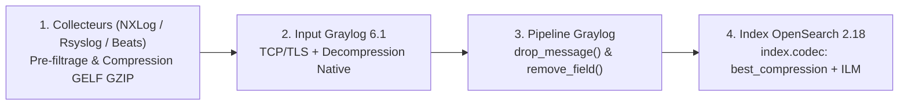

<!-- MASTER-HEADER-START -->
<div align="center">

<a href="https://0xcyberlitech.com/">
  
</a>

<p align="center">
  <a href="https://0xcyberlitech.com/"></a>
  <a href="https://0xcyberlitech.com/soc-rd.html"></a>
  <a href="https://0xcyberlitech.com/jarvis-rd.html"></a>
  <a href="https://github.com/0xCyberLiTech?tab=repositories"></a>
</p>
<p align="center">
  <a href="README.md"></a>
</p>


</div>
<!-- MASTER-HEADER-END -->

<!-- DEBIAN-TRUTH-START -->
> [!IMPORTANT]
>  ** Matrice Officielle Debian — `Debian 12 (Bookworm)` · `Debian 13 (Trixie)` · `Debian 14 (Forky)`**
> - **Sources Officielles Debian.org (`opensearch`) :** `Bookworm (12)` : **`Stable-12`** &nbsp;·&nbsp; `Trixie (13 — Stable)` : **`Stable-13`** &nbsp;·&nbsp; `Forky (14 — Next-Gen)` : **`2.4.1+dfsg-2`**
> - **Références Officielles :** [Paquet Debian Trixie (`default-jre-headless`)](https://packages.debian.org/trixie/default-jre-headless) &nbsp;·&nbsp; [Paquet Debian Forky (`default-jre-headless`)](https://packages.debian.org/forky/default-jre-headless) &nbsp;·&nbsp; [Documentation Officielle Debian](https://www.debian.org/releases/trixie/)
> - **Note d'Ingénierie (Divergence 13 vs 14) :** Sous Debian 13 (Trixie) et Debian 14 (Forky), `/etc/sysctl.conf` monolithique est déprécié au profit de fichiers modulaires dans **`/etc/sysctl.d/99-*.conf`** chargés par `sysctl --system`.

<details>
<summary> <b>Afficher les Encarts Ligne de Commande : Debian 13 (Trixie — Stable) vs Debian 14 (Forky — Next-Gen)</b></summary>

####  Profil Production Stable — Commandes pour `Debian 13 (Trixie)`
```bash
# Debian 13 (Trixie) — Depot GPG en /etc/apt/keyrings/ & suivi systemd :
sudo install -m 0755 -d /etc/apt/keyrings
sudo systemctl status graylog-server && sudo journalctl -u graylog-server -n 50
```

####  Profil Anticipation Next-Gen — Commandes pour `Debian 14 (Forky)`
```bash
# Debian 14 (Forky) — Format DEB822 (/etc/apt/sources.list.d/graylog.sources) & vm.max_map_count :
echo 'vm.max_map_count=262144' | sudo tee /etc/sysctl.d/99-opensearch.conf && sudo sysctl --system
```

</details>
<!-- DEBIAN-TRUTH-END -->

<!-- CIEL-PEDAGOGY-START -->
<details>
<summary> <b>Synthèse d'Architecture, Standards Officiels &amp; Diagnostic (Niveau 1 : Fondamentaux · Niveau 2 : Repères · Niveau 3 : Diagnostic)</b></summary>

- **Niveau 1 — Fondamentaux &amp; Principe d'Architecture :** **Graylog** est une plateforme centralisée de gestion et d'analyse de journaux (**SIEM / Log Management**) articulée autour de trois composants : **MongoDB** (configuration et métadonnées), **OpenSearch** (indexation et recherche temps réel) et **Graylog Server** (ingestion Syslog/GELF, normalisation et alertes).
- **Niveau 2 — Repères Officiels (Ports IANA, Fichiers Debian &amp; Commandes de Validation) :** **Ports standards :** `TCP 9000` (Web UI & API REST Graylog) · `UDP/TCP 5140` ou `1514` (Inputs Syslog/GELF) · `TCP 9200` (OpenSearch local) · `TCP 27017` (MongoDB local) &nbsp;|&nbsp; **Fichier clé :** `/etc/graylog/server/server.conf`.
- **Niveau 3 — Diagnostic d'Incidents &amp; Ingénierie Avancée :** **Diagnostic & Architecture :** Le démarrage de `graylog-server` requiert que `mongod.service` et `opensearch.service` soient actifs et que les paramètres `password_secret` et `root_password_sha2` soient définis. La déportation temps réel des journaux vers un puits isolé est une exigence fondamentale (ANSSI) pour préserver les preuves d'audit en cas de compromission d'un serveur.
- **Sources de Vérité Officielles Éditeurs &amp; Standards :** [Documentation Officielle Graylog](https://go2docs.graylog.org/) &nbsp;·&nbsp; [Documentation Officielle OpenSearch](https://opensearch.org/docs/latest/) &nbsp;·&nbsp; [Recommandations ANSSI Journalisation](https://cyber.gouv.fr/)

</details>
<!-- CIEL-PEDAGOGY-END -->


#  GRAYLOG 6.1 — Optimisation et Réduction de la Bande Passante & du Stockage OpenSearch (Debian 12, 13 & 14)

> **Objectif Opérationnel :** Réduire de **40 % à 70 %** la consommation de bande passante réseau et l'empreinte disque OpenSearch dans **Graylog 6.1+** sous **Debian 12 (Bookworm)**, **Debian 13 (Trixie — Stable)** et **Debian 14 (Forky — Next-Gen)** grâce à la compression **GELF/TLS**, au pré-filtrage à la source, à l'abandon des messages parasites (`drop_message()`) et au codec de stockage **`best_compression` (ZSTD / Deflate)**.

---

##  01 // Architecture d'Optimisation du Flux SIEM


L'optimisation d'une infrastructure Graylog repose sur **4 leviers complémentaires** du collecteur jusqu'au disque NVMe OpenSearch :



| Levier d'Optimisation | Gain Bande Passante | Gain Stockage Disque | Impact CPU |
|:---|:---:|:---:|:---:|
| **1. Pré-filtrage sur l'agent (NXLog / Filebeat)** | **-35 % à -50 %** | **-35 % à -50 %** | Nul sur Graylog |
| **2. Protocole GELF TCP/TLS compressé (GZIP)** | **-65 % à -80 %** | Neutre | Très faible |
| **3. Pipelines Graylog (`drop_message` / `remove_field`)** | Neutre | **-20 % à -35 %** | Faible |
| **4. Codec OpenSearch `best_compression`** | Neutre | **-25 % à -40 %** | Modéré (+5 % CPU) |

---

##  02 // Levier 1 — Activer la Compression et le Pré-Filtrage à la Source


Plutôt que d'envoyer des trames Syslog UDP brutes non compressées, privilégiez **GELF (Graylog Extended Log Format)** qui compresse nativement les charges utiles en **GZIP / ZLIB** ou filtrez les événements bruyants directement sur l'agent.

Exemple de filtrage à la source sous **Debian 12, 13 & 14** avec `rsyslog` (`/etc/rsyslog.d/40-graylog-filter.conf`) pour ignorer le bruit périodique avant envoi réseau :

<!-- CODE-WINDOW-START -->
> [!CAUTION]
> 
>
> ```bash
> # Ignorer les sessions cron repetitives non critiques avant envoi vers Graylog :
> if ($programname == 'CRON' and $msg contains 'pam_unix(cron:session)') then stop
>
> # Envoyer le reste en TCP compresse (compression zlib niveau 6) vers Graylog :
> action(
>     type="omfwd"
>     Target="192.168.1.110"
>     Port="1514"
>     Protocol="tcp"
>     Compression.Mode="stream:always"
>     StreamDriverPermittedPeers="*.cyberlitech.local"
> )
> ```
<!-- CODE-WINDOW-END -->

---

##  03 // Levier 2 — Élaguer les Champs Inutiles et les Événements Bruités par Pipeline Graylog


Dans **System > Pipelines > Manage rules**, créez deux règles pour :
1. **Supprimer intégralement (`drop_message`)** les événements de télémétrie bruyants (ex. événements Windows `4662`, `5156` ou healthchecks HTTP `200 OK` locaux).
2. **Purger les champs redondants (`remove_field`)** qui doublonnent le message brut dans OpenSearch.

###  Règle Pipeline 1 : Suppression des événements de bruit pur

<!-- CODE-WINDOW-START -->
> [!CAUTION]
> 
>
> ```bash
> rule "Drop Noise Healthchecks and Verbose Filtering Platform"
> when
>     has_field("event_id") AND (to_string($message.event_id) == "5156" OR to_string($message.event_id) == "4658")
> then
>     drop_message();
> end
> ```
<!-- CODE-WINDOW-END -->

###  Règle Pipeline 2 : Suppression des champs volumineux redondants après extraction

<!-- CODE-WINDOW-START -->
> [!CAUTION]
> 
>
> ```bash
> rule "Strip Redundant Full Message After Parsing"
> when
>     has_field("full_message") AND has_field("action") AND has_field("src_ip")
> then
>     remove_field("full_message");
> end
> ```
<!-- CODE-WINDOW-END -->

---

##  04 // Levier 3 — Activer `best_compression` dans OpenSearch 2.x


Sur votre serveur **Debian 12, 13 (Trixie) ou 14 (Forky)** hébergeant OpenSearch, appliquez un modèle d'index (`Index Template`) activant le codec **`best_compression`** sur tous les index `graylog_*` :

<!-- CODE-WINDOW-START -->
> [!CAUTION]
> 
>
> ```bash
> curl -X PUT "http://127.0.0.1:9200/_index_template/graylog_best_compression" \
>   -H 'Content-Type: application/json' -d'
> {
>   "index_patterns": ["graylog_*"],
>   "priority": 200,
>   "template": {
>     "settings": {
>       "index.codec": "best_compression",
>       "index.refresh_interval": "10s"
>     }
>   }
> }'
> ```
<!-- CODE-WINDOW-END -->

Pour appliquer immédiatement la compression maximale et fusionner les segments Lucene sur les index déjà tournés :

<!-- CODE-WINDOW-START -->
> [!CAUTION]
> 
>
> ```bash
> curl -X POST "http://127.0.0.1:9200/graylog_*/_forcemerge?max_num_segments=1"
> ```
<!-- CODE-WINDOW-END -->

---

##  05 // Levier 4 — Politique de Rétention et Rotation Déterministe des Index


Dans l'interface Web Graylog (**System > Indices > Default index set > Edit**) :
- **Rotation Strategy** : `Index Size` (**`10 GiB`** par index) ou `Index Time` (`P1D` — 1 jour).
- **Retention Strategy** : `Delete Index` avec un plafond strict adapté à la taille de votre partition `/var/lib/opensearch` (ne jamais dépasser **80 %** d'occupation disque pour préserver le watermark OpenSearch).

Vérifiez l'espace disque réellement consommé par chaque index OpenSearch :

<!-- CODE-WINDOW-START -->
> [!CAUTION]
> 
>
> ```bash
> curl -s "http://127.0.0.1:9200/_cat/indices/graylog_*?v&s=store.size:desc"
> ```
<!-- CODE-WINDOW-END -->

<!-- MASTER-FOOTER-START -->
<div align="center">


<a href="https://0xcyberlitech.com/">
  
</a>

<p align="center"><a href="https://0xcyberlitech.com/"></a></p>

<sub><b>Architecturé &amp; Forgé par Marc &amp; Antigravity (Google DeepMind)</b> &nbsp;·&nbsp; <a href="https://0xcyberlitech.com/"><b>0xcyberlitech.com</b></a> &nbsp;·&nbsp; <a href="https://0xcyberlitech.com/soc-rd.html">Architecture SOC Cockpit v5.5</a> &nbsp;·&nbsp; <a href="https://0xcyberlitech.com/jarvis-rd.html">Architecture JARVIS Mark-VII</a> &nbsp;·&nbsp; <a href="https://0xcyberlitech.com/blueprint-jarvis.html">Blueprint Matériel RTX 5080</a></sub>

</div>
<!-- MASTER-FOOTER-END -->
