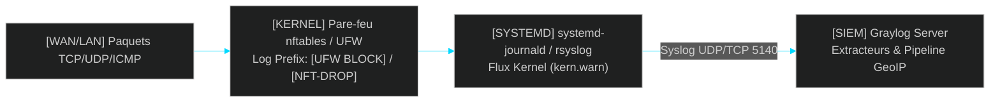

<!-- MASTER-HEADER-START -->
<div align="center">

<a href="https://0xcyberlitech.com/">
  
</a>

<p align="center">
  <a href="https://0xcyberlitech.com/"></a>
  <a href="https://0xcyberlitech.com/soc-rd.html"></a>
  <a href="https://0xcyberlitech.com/jarvis-rd.html"></a>
  <a href="https://github.com/0xCyberLiTech?tab=repositories"></a>
</p>
<p align="center">
  <a href="README.md"></a>
</p>


</div>
<!-- MASTER-HEADER-END -->

<!-- DEBIAN-TRUTH-START -->
> [!IMPORTANT]
>  ** Matrice Officielle Debian — `Debian 12 (Bookworm)` · `Debian 13 (Trixie)` · `Debian 14 (Forky)`**
> - **Sources Officielles Debian.org (`opensearch`) :** `Bookworm (12)` : **`Stable-12`** &nbsp;·&nbsp; `Trixie (13 — Stable)` : **`Stable-13`** &nbsp;·&nbsp; `Forky (14 — Next-Gen)` : **`2.4.1+dfsg-2`**
> - **Références Officielles :** [Paquet Debian Trixie (`default-jre-headless`)](https://packages.debian.org/trixie/default-jre-headless) &nbsp;·&nbsp; [Paquet Debian Forky (`default-jre-headless`)](https://packages.debian.org/forky/default-jre-headless) &nbsp;·&nbsp; [Documentation Officielle Debian](https://www.debian.org/releases/trixie/)
> - **Note d'Ingénierie (Divergence 13 vs 14) :** Sous Debian 13 (Trixie) et Debian 14 (Forky), `/etc/sysctl.conf` monolithique est déprécié au profit de fichiers modulaires dans **`/etc/sysctl.d/99-*.conf`** chargés par `sysctl --system`.

<details>
<summary> <b>Afficher les Encarts Ligne de Commande : Debian 13 (Trixie — Stable) vs Debian 14 (Forky — Next-Gen)</b></summary>

####  Profil Production Stable — Commandes pour `Debian 13 (Trixie)`
```bash
# Debian 13 (Trixie) — Depot GPG en /etc/apt/keyrings/ & suivi systemd :
sudo install -m 0755 -d /etc/apt/keyrings
sudo systemctl status graylog-server && sudo journalctl -u graylog-server -n 50
```

####  Profil Anticipation Next-Gen — Commandes pour `Debian 14 (Forky)`
```bash
# Debian 14 (Forky) — Format DEB822 (/etc/apt/sources.list.d/graylog.sources) & vm.max_map_count :
echo 'vm.max_map_count=262144' | sudo tee /etc/sysctl.d/99-opensearch.conf && sudo sysctl --system
```

</details>
<!-- DEBIAN-TRUTH-END -->

<!-- CIEL-PEDAGOGY-START -->
<details>
<summary> <b>Synthèse d'Architecture, Standards Officiels &amp; Diagnostic (Niveau 1 : Fondamentaux · Niveau 2 : Repères · Niveau 3 : Diagnostic)</b></summary>

- **Niveau 1 — Fondamentaux &amp; Principe d'Architecture :** **Graylog** est une plateforme centralisée de gestion et d'analyse de journaux (**SIEM / Log Management**) articulée autour de trois composants : **MongoDB** (configuration et métadonnées), **OpenSearch** (indexation et recherche temps réel) et **Graylog Server** (ingestion Syslog/GELF, normalisation et alertes).
- **Niveau 2 — Repères Officiels (Ports IANA, Fichiers Debian &amp; Commandes de Validation) :** **Ports standards :** `TCP 9000` (Web UI & API REST Graylog) · `UDP/TCP 5140` ou `1514` (Inputs Syslog/GELF) · `TCP 9200` (OpenSearch local) · `TCP 27017` (MongoDB local) &nbsp;|&nbsp; **Fichier clé :** `/etc/graylog/server/server.conf`.
- **Niveau 3 — Diagnostic d'Incidents &amp; Ingénierie Avancée :** **Diagnostic & Architecture :** Le démarrage de `graylog-server` requiert que `mongod.service` et `opensearch.service` soient actifs et que les paramètres `password_secret` et `root_password_sha2` soient définis. La déportation temps réel des journaux vers un puits isolé est une exigence fondamentale (ANSSI) pour préserver les preuves d'audit en cas de compromission d'un serveur.
- **Sources de Vérité Officielles Éditeurs &amp; Standards :** [Documentation Officielle Graylog](https://go2docs.graylog.org/) &nbsp;·&nbsp; [Documentation Officielle OpenSearch](https://opensearch.org/docs/latest/) &nbsp;·&nbsp; [Recommandations ANSSI Journalisation](https://cyber.gouv.fr/)
- **Livres Blancs &amp; 67 Podcasts Audio R&amp;D :** [Portail 0xCyberLiTech](https://0xcyberlitech.com/) &nbsp;·&nbsp; [Livre Blanc SOC Cockpit v5.5](https://0xcyberlitech.com/soc-rd.html) &nbsp;·&nbsp; [Livre Blanc JARVIS Mark-VII](https://0xcyberlitech.com/jarvis-rd.html) &nbsp;·&nbsp; [Blueprint Logiciel &amp; Matériel RTX 5080](https://0xcyberlitech.com/blueprint-jarvis.html)

</details>
<!-- CIEL-PEDAGOGY-END -->


#  Supervision des Connexions Pare-feu Entrantes & Sortantes (`nftables` / `UFW`) dans Graylog (Debian 13 & 14)

##  01 // OBJECTIF OPÉRATIONNEL & ARCHITECTURE DE COLLECTE PARE-FEU


La visibilité temps réel sur les flux **bloqués (`BLOCK` / `DROP`)** et **autorisés (`ALLOW` / `ACCEPT`)** au niveau du pare-feu périmétrique ou hôte est un pilier fondamental d'un **SOC (Security Operations Center)**.

Sous **Debian 13 (Trixie — Stable)** et **Debian 14 (Forky — Next-Gen)**, le pare-feu repose nativement sur le sous-système noyau **`nftables`** (piloté directement ou via **UFW**) et les événements kernel sont captés par **`systemd-journald`**.



---

##  02 // ACTIVATION DE LA JOURNALISATION NOYAU (`UFW` & `NFTABLES`)


###  A. Activation du logging sur UFW (Debian 13 Trixie & Debian 14 Forky)

Activez la journalisation en niveau `low` ou `medium` pour tracer tous les paquets rejetés par la politique par défaut sans saturer le disque :

<!-- CODE-WINDOW-START -->
> [!CAUTION]
> 
>
> ```bash
> sudo ufw logging low
> sudo ufw status verbose
> sudo journalctl -k -n 20 --no-hostname | grep -i "UFW"
> ```
<!-- CODE-WINDOW-END -->

###  B. Activation du logging direct dans une règle `nftables` native

Dans `/etc/nftables.conf`, ajoutez l'instruction `log prefix "[NFT-DROP] "` avant la décision `drop` :

<!-- CODE-WINDOW-START -->
> [!CAUTION]
> 
>
> ```bash
> sudo nft add rule inet filter input tcp dport { 23, 445, 3389 } log prefix \"[NFT-DROP-SCAN] \" counter drop
> sudo nft list ruleset
> ```
<!-- CODE-WINDOW-END -->

---

##  03 // TRANSFERT DES JOURNAUX PARE-FEU VERS GRAYLOG


Créez la règle de transfert dédiée `/etc/rsyslog.d/20-graylog-firewall.conf` pour expédier instantanément chaque log kernel contenant `[UFW ` ou `[NFT-` vers l'Input **Syslog UDP/TCP (port 5140)** de votre serveur Graylog :

<!-- CODE-WINDOW-START -->
> [!CAUTION]
> 
>
> ```ini
> # /etc/rsyslog.d/20-graylog-firewall.conf
> if ($msg contains '[UFW ' or $msg contains '[NFT-') then {
>     action(
>         type="omfwd"
>         target="192.168.1.50"
>         port="5140"
>         protocol="udp"
>         queue.type="LinkedList"
>         queue.filename="graylog_fw_q"
>         action.resumeRetryCount="-1"
>     )
>     stop
> }
> ```
<!-- CODE-WINDOW-END -->

Redémarrez et validez le démon d'expédition :

<!-- CODE-WINDOW-START -->
> [!CAUTION]
> 
>
> ```bash
> sudo rsyslogd -N1
> sudo systemctl restart rsyslog
> sudo systemctl status rsyslog --no-pager
> ```
<!-- CODE-WINDOW-END -->

---

##  04 // RÈGLE DE PIPELINE GRAYLOG (EXTRACTION `SRC`, `DST`, `DPT`, `PROTO`)


Dans **Graylog (`System > Pipelines > Manage rules`)**, créez une règle d'extraction automatique des champs réseau à partir des journaux noyau Linux :

<!-- CODE-WINDOW-START -->
> [!CAUTION]
> 
>
> ```yaml
> rule "Extract Linux Firewall Fields (UFW / nftables)"
> when
>     has_field("message") AND (contains(to_string($message.message), "[UFW ") OR contains(to_string($message.message), "[NFT-"))
> then
>     let kv = key_value(
>         value: to_string($message.message),
>         delimiters: " ",
>         kv_delimiters: "="
>     );
>     set_fields(kv);
>     // Normalisation des champs pour les tableaux de bord SOC
>     set_field("fw_src_ip", to_string($message.SRC));
>     set_field("fw_dst_ip", to_string($message.DST));
>     set_field("fw_dst_port", to_long($message.DPT));
>     set_field("fw_proto", to_string($message.PROTO));
> end
> ```
<!-- CODE-WINDOW-END -->

<!-- MASTER-FOOTER-START -->
<div align="center">


<a href="https://0xcyberlitech.com/">
  
</a>

<p align="center"><a href="https://0xcyberlitech.com/"></a></p>

<sub><b>Architecturé &amp; Forgé par Marc &amp; Antigravity (Google DeepMind)</b> &nbsp;·&nbsp; <a href="https://0xcyberlitech.com/"><b>0xcyberlitech.com</b></a> &nbsp;·&nbsp; <a href="https://0xcyberlitech.com/soc-rd.html">Architecture SOC Cockpit v5.5</a> &nbsp;·&nbsp; <a href="https://0xcyberlitech.com/jarvis-rd.html">Architecture JARVIS Mark-VII</a> &nbsp;·&nbsp; <a href="https://0xcyberlitech.com/blueprint-jarvis.html">Blueprint Matériel RTX 5080</a></sub>

</div>
<!-- MASTER-FOOTER-END -->
